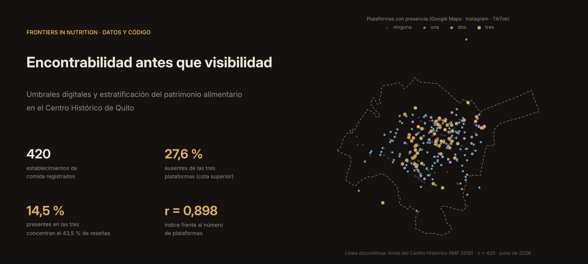

<p align="center">
  
</p>

<p align="center">
  <a href="README.md">English</a> · <b>Español</b>
</p>

<p align="center">
  <a href="https://doi.org/10.5281/zenodo.22178448"></a>
  <a href="LICENSE"></a>
  <a href="https://jijadan.github.io/quito-digital-foodscape/"></a>
  
  
  
</p>

# Encontrabilidad antes que visibilidad

**Datos, código y mapas interactivos del artículo** *Findability before visibility: digital thresholds and the stratification of food heritage in historic urban centres* (Jadán-Altamirano y Jadán-Guerrero, *Frontiers in Nutrition*, en revisión).

La investigación sobre paisajes alimentarios digitales suele construir sus muestras desde las propias plataformas. Por eso observa sobre todo lo que esas plataformas ya muestran. Este estudio parte del otro extremo. Toma el censo de los 420 establecimientos de comida inscritos en el catastro turístico municipal del Centro Histórico de Quito, construido sin tener en cuenta ninguna presencia digital, y registra después si cada uno aparece en Google Maps, Instagram y TikTok y cuánto reconocimiento ha acumulado allí.

<p align="center">
  <a href="https://jijadan.github.io/quito-digital-foodscape/mapa-territorios-digitales-quito.html"></a>
  &nbsp;
  <a href="https://jijadan.github.io/quito-digital-foodscape/digital-food-territories-quito.html"></a>
</p>

---

## Contenido

- [Hallazgos principales](#hallazgos-principales)
- [Figuras](#figuras)
- [Estructura del repositorio](#estructura-del-repositorio)
- [Datos](#datos)
- [Reproducir el análisis](#reproducir-el-análisis)
- [Primera revisión (R1)](#primera-revisión-r1)
- [Mapa interactivo](#mapa-interactivo)
- [Notas sobre los datos](#notas-sobre-los-datos)
- [Cómo citar](#cómo-citar)
- [Autores y agradecimientos](#autores-y-agradecimientos)
- [Licencia](#licencia)

## Hallazgos principales

El diseño es transversal. Todas las relaciones que siguen son asociaciones, no efectos causales.

| | Hallazgo |
|---|---|
| **28 m** | Los máximos de la superficie de densidad física y de la superficie de visibilidad digital distan 28 m, y ambas superficies correlacionan en ρ = 0,96. La visibilidad digital no aparece desplazada espacialmente respecto de la estructura física de la oferta. |
| **27,6 %** | Proporción del censo sin presencia en ninguna de las tres plataformas y sin reseñas. Es una cota superior. La verificación en línea de octubre de 2026 la acota a entre un quinto y un cuarto del censo. |
| **14,5 % → 43,5 %** | Los establecimientos presentes en las tres plataformas concentran el 43,5 % de todas las reseñas de Google Maps. |
| **r = 0,898** | Correlación entre el índice digital compuesto y el simple recuento de plataformas activas. La principal discontinuidad está en la entrada al ecosistema de plataformas, no en lo acumulado una vez dentro. |
| **85,2 % frente a 19,0 %** | Presencia en Instagram de los restaurantes de nueva cocina tradicional (reinterpretada), frente a la cocina tradicional no traducida. |

El artículo propone la **encontrabilidad**, la condición de estar presente en las plataformas en las que la gente busca dónde comer, como propiedad analítica del territorio alimentario digital. La digitalización no sustituye la geografía gastronómica patrimonial. Añade un umbral que se asocia con quién entra en el campo de la visibilidad y, una vez dentro, cuánto reconocimiento puede acumular.

## Figuras

Todas las figuras se generan con el código de este repositorio. Las versiones en alta resolución acompañan al artículo. Los rótulos de las figuras están en inglés, como en el artículo.

<p align="center">
  <br>
  <sub><b>Figura 2.</b> Distribución de los establecimientos y de las reseñas acumuladas en Google Maps según el número de plataformas activas. n = 420.</sub>
</p>

<p align="center">
  <br>
  <sub><b>Figura 5.</b> (A) Densidad de establecimientos, (B) visibilidad cartográfica ponderada por log(1 + reseñas), (C) índice digital esperado por establecimiento (B/A). Núcleo gaussiano, h = 125 m.</sub>
</p>

<p align="center">
  <br>
  <sub><b>Figura 6.</b> Concentración local de (A) el volumen de reseñas y (B) el índice compuesto, Getis-Ord Gi* en celdas de 150 m. Las celdas con contorno sobreviven a la corrección de Benjamini-Hochberg.</sub>
</p>

<details>
<summary><b>Más figuras</b> (área de estudio, anidamiento de plataformas, regresión, franquicias, núcleo robusto)</summary>
<br>

<p align="center">
  <br>
  <sub><b>Figura 1.</b> Área de estudio y censo (n = 420). La línea discontinua marca el límite del Centro Histórico, digitalizado del Instituto Metropolitano de Patrimonio (2019); 408 de los 420 establecimientos quedan dentro. Mapa base © colaboradores de OpenStreetMap (ODbL).</sub>
</p>

<p align="center">
  <br>
  <sub><b>Figura 3.</b> Combinaciones de redes sociales. Los 63 establecimientos con cuenta en TikTok tienen también cuenta en Instagram (prueba exacta de Fisher, p &lt; 0,001).</sub>
</p>

<p align="center">
  <br>
  <sub><b>Figura 4.</b> Regresión binomial negativa del volumen de reseñas: razones de tasas de incidencia con intervalos de confianza del 95 %. Categoría de referencia: Tradicional.</sub>
</p>

<p align="center">
  <br>
  <sub><b>Figura 7.</b> Las franquicias acumulan más reseñas (r biserial de rangos = 0,65) y reciben calificaciones más bajas (r = −0,46) que los establecimientos independientes.</sub>
</p>

<p align="center">
  <br>
  <sub><b>Figura suplementaria S8.1.</b> Núcleo robusto. Color: proporción de 20 mallas (cinco tamaños de celda × cuatro orígenes) en que cada establecimiento cae en una celda caliente del índice que sobrevive a la corrección de Benjamini-Hochberg. Anillos negros: proporción ≥ 0,75 (n = 38).</sub>
</p>

</details>

## Estructura del repositorio

```
quito-digital-foodscape/
├── index.html                              Página de inicio (GitHub Pages)
├── digital-food-territories-quito.html     Mapa interactivo, inglés
├── mapa-territorios-digitales-quito.html   Mapa interactivo, español
├── data/
│   ├── restaurantes_quito_CH_clean.csv     Censo usado en el artículo (n = 420)
│   ├── README.md                           Diccionario de datos (inglés / español)
│   ├── geo/                                Límite del Centro Histórico (IMP 2019), GeoPackage y GeoJSON
│   └── revision-R1/                        Datos añadidos en la primera revisión
│       ├── verification/                   Verificación en línea de los 116 establecimientos sin plataformas
│       ├── typology-coding/                Respuestas anonimizadas de los cuatro chefs independientes
│       ├── typology-results/               Fiabilidad de la tipología (Suplementario S6)
│       └── sensitivity/                    Análisis de sensibilidad (Suplementario S7–S8)
├── code/
│   ├── analysis/                           Flujo de análisis original y figuras del artículo (Python)
│   ├── revision-R1/                        Scripts añadidos en la primera revisión (Python)
│   ├── data-collection/                    Geocodificación y validación (Google Apps Script)
│   ├── interactive-map/                    Generador del mapa (Google Apps Script)
│   └── coding-app/                         Aplicación web con la que los chefs codificaron la tipología (Google Apps Script)
├── assets/                                 Banner y figuras de este README
├── tools/                                  Scripts que dibujan el banner y la página de inicio a partir de los datos
├── CITATION.cff · CHANGELOG.md · requirements.txt · LICENSE
```

## Datos

El archivo principal es [`data/restaurantes_quito_CH_clean.csv`](data/restaurantes_quito_CH_clean.csv): 420 filas, una por establecimiento, y 29 columnas. Es el mismo archivo que lee el análisis. El [diccionario de datos](data/README.md#español) describe cada columna, cada categoría y los archivos añadidos en la revisión.

| Fuente | Contenido | Fecha |
|---|---|---|
| Catastro turístico del Distrito Metropolitano de Quito | Marco muestral: nombre, dirección, año de registro, categoría (tenedores) | Catastro publicado |
| Google Maps | Ficha, calificación media, número de reseñas | Junio de 2026 |
| Instagram, TikTok | Cuenta, seguidores, likes acumulados (TikTok) | Junio de 2026 |
| Verificación en línea | Estado de los 116 establecimientos sin plataformas | Octubre de 2026 |

## Reproducir el análisis

```bash
git clone https://github.com/Jijadan/quito-digital-foodscape.git
cd quito-digital-foodscape
python -m venv .venv && source .venv/bin/activate      # Windows: .venv\Scripts\activate
pip install -r requirements.txt

# Análisis principal: índice, superficies KDE, Getis-Ord Gi*, regresión, tablas y figuras
python code/analysis/analisis_espacial_quito_v2_capital_digital.py \
       --csv data/restaurantes_quito_CH_clean.csv --outdir outputs/
```

El script escribe las figuras (PDF vectorial y PNG a 600 dpi) y las tablas (CSV) en `outputs/`. Los scripts de la revisión se documentan en [`code/revision-R1/README.md`](code/revision-R1/README.md).

## Primera revisión (R1)

Los revisores pidieron comprobaciones adicionales. Todo lo añadido en respuesta está en este repositorio.

- **Verificación en línea de los 116 establecimientos sin plataformas** (octubre de 2026, Suplementario S7). 13 aparecen cerrados o trasladados, 6 muestran evidencia de funcionamiento y de 97 no se encontró evidencia en línea. Por eso la proporción sin plataformas se presenta como un rango con escenarios de cierre.
- **Fiabilidad de la tipología** (Suplementario S6). Cuatro chefs independientes codificaron a ciegas una muestra a partir de fotografías de Google Maps. El acuerdo entre ellos fue bajo (α de Krippendorff = 0,39). Donde al menos tres coincidieron, su etiqueta coincidió con la original en el 73 % de los casos. La diferencia en Instagram entre la nueva cocina tradicional y la tradicional se mantiene con todas las codificaciones alternativas (razones de odds de 7,8 a 24,5; todas p < 0,001).
- **Sensibilidad espacial** (Suplementario S8). Anchos de banda de 75 a 250 m, mallas de 100 a 250 m con orígenes desplazados, estadística a nivel de punto y efectos de borde.
- **Límite del estudio.** El límite del Centro Histórico se digitalizó del Instituto Metropolitano de Patrimonio (2019) y se dibuja en todos los mapas.
- **Rótulos del mapa.** Los mapas interactivos usan ahora los nombres de categoría del artículo (*Sin clasificar*, *Cocina ecuatoriana regional*, *Parrilla*).

La lista completa de cambios está en [`CHANGELOG.md`](CHANGELOG.md).

## Mapa interactivo

Los dos mapas muestran los 420 establecimientos con filtros por tipo y por plataforma, capas de burbujas para seguidores y calificaciones, y un mapa de calor de reseñas. Son páginas HTML estáticas hechas con [Leaflet](https://leafletjs.com/) y servidas por GitHub Pages. Se generaron desde la hoja de cálculo de la investigación con [`code/interactive-map/Code.gs`](code/interactive-map/Code.gs) (funciones `generarMapaHtml()` para español y `generarMapaHtmlEn()` para inglés). Mapa base © colaboradores de [OpenStreetMap](https://www.openstreetmap.org/copyright).

## Notas sobre los datos

- **Ausencia no es cierre.** Un establecimiento sin plataformas puede estar abierto pero fuera de línea, cerrado, trasladado o presente en plataformas no examinadas (por ejemplo, Facebook).
- **Reseñas y seguidores miden cosas distintas.** Una reseña la escribe alguien que estuvo en el lugar. Un seguidor puede pertenecer a la cuenta de una marca nacional y procede de una audiencia de origen geográfico no especificado.
- **Los campos de plataformas son mediciones de investigación.** La presencia, los seguidores y los likes se registraron manualmente como valores fechados, agregados y visibles públicamente. No son una exportación ni un raspado de ninguna plataforma y no contienen contenido de las plataformas ni datos personales de usuarios. Los valores corresponden a junio de 2026.
- **No es un directorio.** Los datos son para investigación y divulgación. No son un directorio comercial ni una recomendación de ningún establecimiento.
- **Retenido a propósito.** La llave que vincula los códigos ciegos de los chefs con los establecimientos, y las fotografías que se les mostraron, no se publican.

## Cómo citar

Cite el artículo y, si usa los datos o el código, el conjunto de datos archivado.

> Jadán-Altamirano, J., y Jadán-Guerrero, J. (2026). Findability before visibility: digital thresholds and the stratification of food heritage in historic urban centres. *Frontiers in Nutrition* (en revisión).

> Jadán-Altamirano, J. (2026). *Jijadan/quito-digital-foodscape: v1.0.1 — Public release* (Versión v1.0.1) [Conjunto de datos]. Zenodo. https://doi.org/10.5281/zenodo.22178448

```bibtex
@misc{jadanaltamirano2026dataset,
  author    = {Jad{\'a}n-Altamirano, Johann},
  title     = {Jijadan/quito-digital-foodscape: v1.0.1 --- Public release},
  year      = {2026},
  publisher = {Zenodo},
  version   = {v1.0.1},
  doi       = {10.5281/zenodo.22178448}
}
```

El botón **Cite this repository** de GitHub usa [`CITATION.cff`](CITATION.cff). La referencia del artículo se actualizará con su DOI al publicarse.

## Autores y agradecimientos

- **Johann Jadán-Altamirano** — Laboratorio Génesis (Labgenesis Cía. Ltda.), Ambato, Ecuador
- **Janio Jadán-Guerrero** (autor de correspondencia) — Universidad Tecnológica Indoamérica, Quito, Ecuador

El trabajo fue financiado por la Universidad Tecnológica Indoamérica. Agradecemos a Laboratorio Génesis su apoyo, y al Chef Israel Yánez (Universidad UTE), al Chef Jorge Jaramillo (USFQ), al Chef Elías Bohórquez y al Chef Ismael Villacrés (UIDE) la codificación de la tipología.

Para preguntas sobre los datos, abra un [issue](https://github.com/Jijadan/quito-digital-foodscape/issues) o escriba al autor de correspondencia con los datos de contacto que figuran en el artículo.

## Licencia

Los datos, mapas, figuras y código se publican bajo la licencia [Creative Commons Atribución 4.0 Internacional (CC BY 4.0)](LICENSE). Puede compartirlos y adaptarlos con cualquier fin, siempre que dé el crédito adecuado citando el artículo y el conjunto de datos.
