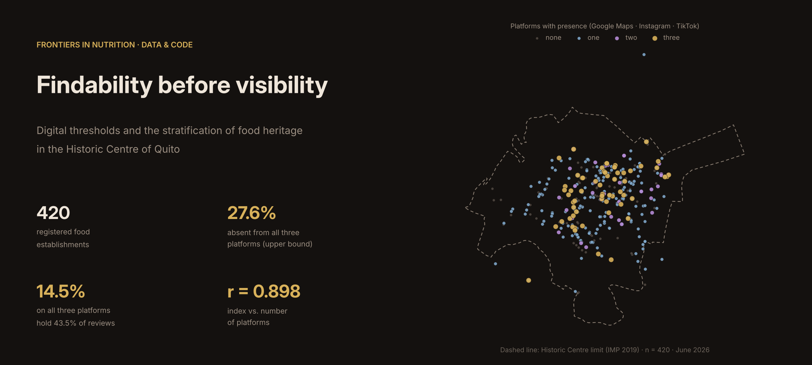
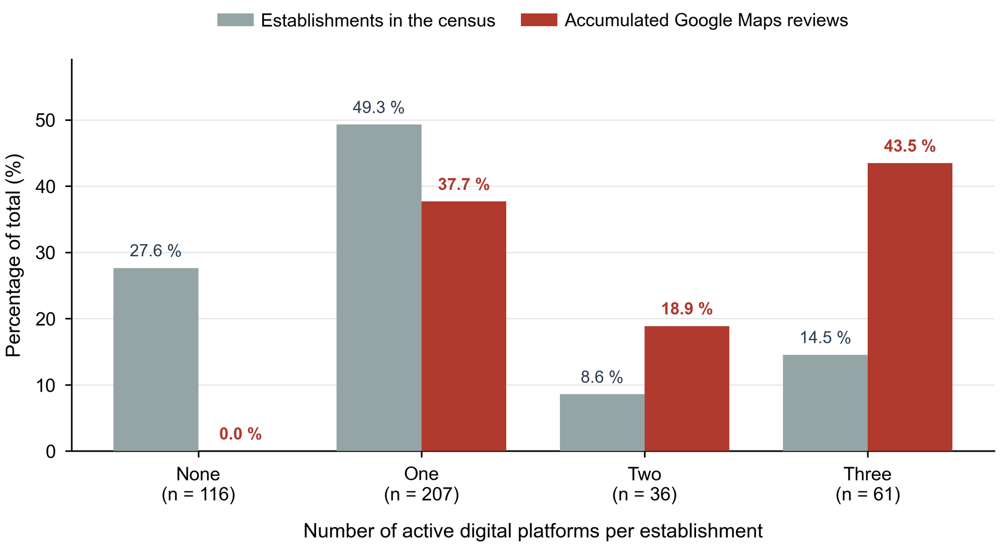
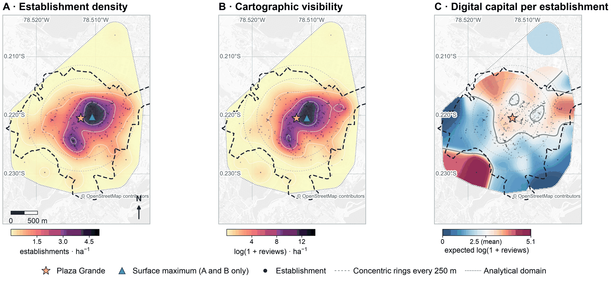
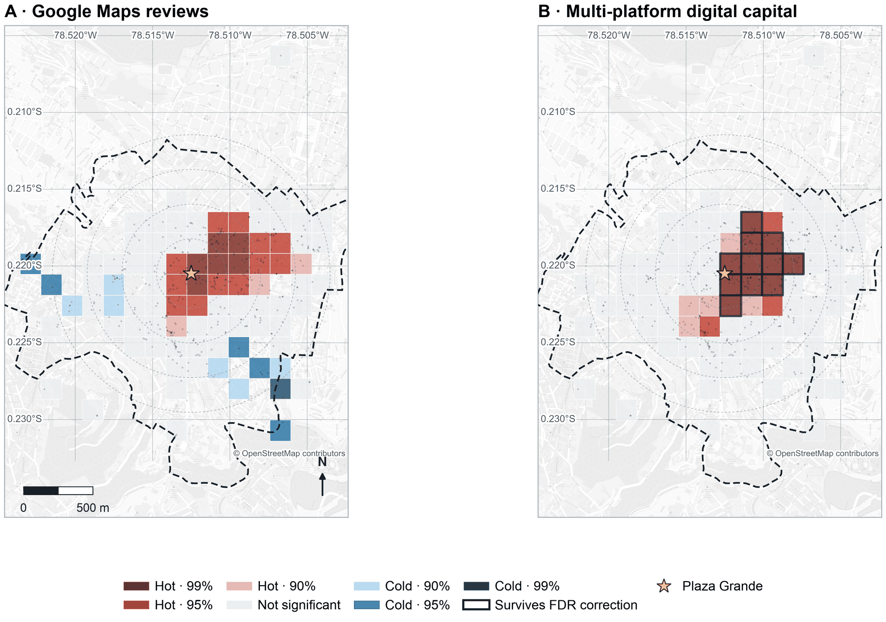
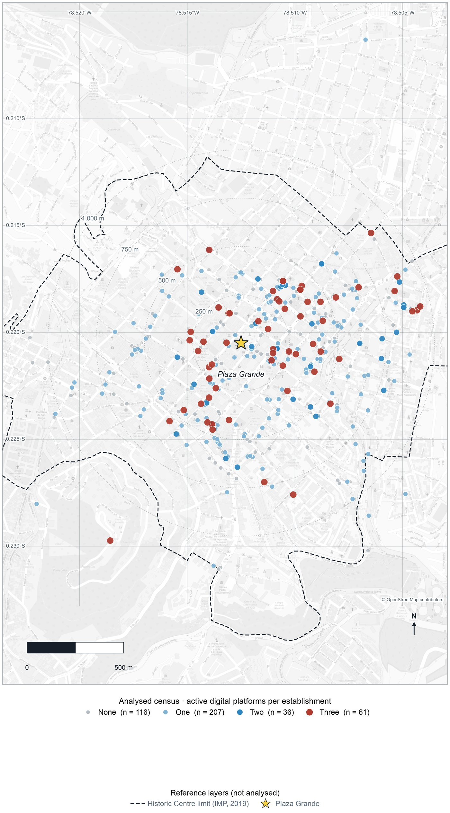
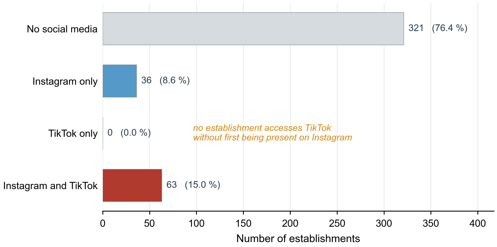
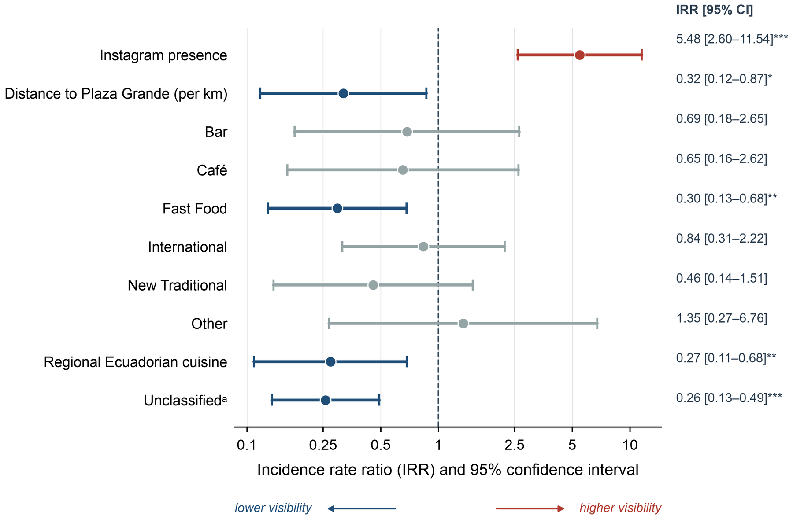
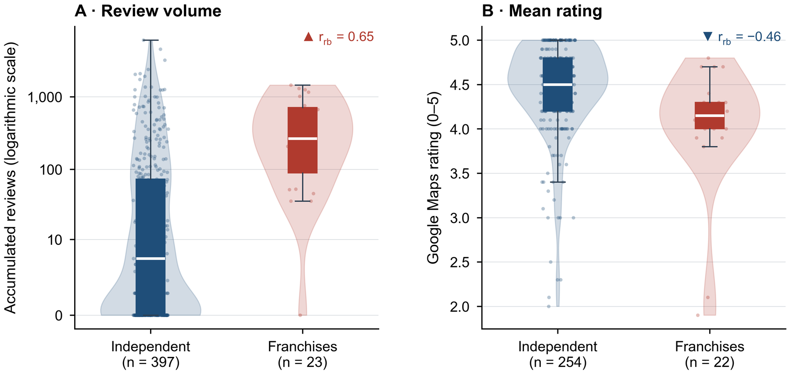
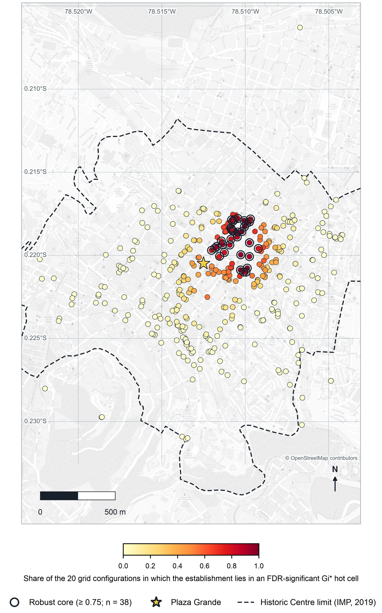

<p align="center">
  
</p>

<p align="center">
  <b>English</b> · <a href="README.es.md">Español</a>
</p>

<p align="center">
  <a href="https://doi.org/10.5281/zenodo.22178448"></a>
  <a href="LICENSE"></a>
  <a href="https://jijadan.github.io/quito-digital-foodscape/"></a>
  
  
  
</p>

# Findability before visibility

**Data, code and interactive maps for the article** *Findability before visibility: digital thresholds and the stratification of food heritage in historic urban centres* (Jadán-Altamirano and Jadán-Guerrero, *Frontiers in Nutrition*, under review).

Research on digital foodscapes usually builds its samples from the platforms themselves. It therefore sees mainly what those platforms already show. This study starts from the other end. It takes a census of the 420 food establishments listed in the municipal tourism registry of Quito's Historic Centre, built without reference to any digital presence, and then records whether each one appears on Google Maps, Instagram and TikTok and how much recognition it has accumulated there.

<p align="center">
  <a href="https://jijadan.github.io/quito-digital-foodscape/digital-food-territories-quito.html"></a>
  &nbsp;
  <a href="https://jijadan.github.io/quito-digital-foodscape/mapa-territorios-digitales-quito.html"></a>
</p>

---

## Contents

- [Key findings](#key-findings)
- [Figures](#figures)
- [Repository structure](#repository-structure)
- [Data](#data)
- [Reproducing the analysis](#reproducing-the-analysis)
- [First revision (R1)](#first-revision-r1)
- [Interactive map](#interactive-map)
- [Notes on the data](#notes-on-the-data)
- [How to cite](#how-to-cite)
- [Authors and acknowledgements](#authors-and-acknowledgements)
- [License](#license)

## Key findings

The design is cross-sectional. All relationships below are associations, not causal effects.

| | Finding |
|---|---|
| **28 m** | The maxima of the physical density surface and the digital visibility surface lie 28 m apart, and the two surfaces correlate at ρ = 0.96. Digital visibility does not appear spatially displaced from the physical structure of the food offer. |
| **27.6 %** | Share of the census with no presence on any of the three platforms and no reviews. This is an upper bound. Online verification in October 2026 narrows it to between a fifth and a quarter of the census. |
| **14.5 % → 43.5 %** | The establishments present on all three platforms hold 43.5 % of all Google Maps reviews. |
| **r = 0.898** | Correlation between the composite digital index and the simple count of active platforms. The main break lies at entry into the platform ecosystem, not in the amount accumulated once inside. |
| **85.2 % vs 19.0 %** | Instagram presence among restaurants serving new (reinterpreted) traditional cuisine, compared with untranslated traditional cuisine. |

The article proposes **findability**, the condition of being present on the platforms through which people look for places to eat, as an analytical property of the digital food territory. Digitalization does not replace the heritage food geography. It adds a threshold that is associated with who enters the field of visibility and, once inside, how much recognition can be accumulated.

## Figures

All figures are generated by the code in this repository. Full-resolution versions accompany the article.

<p align="center">
  <br>
  <sub><b>Figure 2.</b> Distribution of establishments and of accumulated Google Maps reviews by number of active platforms. n = 420.</sub>
</p>

<p align="center">
  <br>
  <sub><b>Figure 5.</b> (A) Establishment density, (B) cartographic visibility weighted by log(1 + reviews), (C) expected digital index per establishment (B/A). Gaussian kernel, h = 125 m.</sub>
</p>

<p align="center">
  <br>
  <sub><b>Figure 6.</b> Local concentration of (A) review volume and (B) the composite index, Getis-Ord Gi* on 150 m cells. Outlined cells survive the Benjamini-Hochberg correction.</sub>
</p>

<details>
<summary><b>More figures</b> (study area, platform nesting, regression, franchises, robust core)</summary>
<br>

<p align="center">
  <br>
  <sub><b>Figure 1.</b> Study area and census (n = 420). The dashed line marks the Historic Centre limit, digitized from the Instituto Metropolitano de Patrimonio (2019); 408 of the 420 establishments lie within it. Basemap © OpenStreetMap contributors (ODbL).</sub>
</p>

<p align="center">
  <br>
  <sub><b>Figure 3.</b> Social media combinations. All 63 establishments with a TikTok account also hold an Instagram account (Fisher's exact test, p &lt; 0.001).</sub>
</p>

<p align="center">
  <br>
  <sub><b>Figure 4.</b> Negative binomial regression of review volume: incidence rate ratios with 95 % confidence intervals. Reference category: Traditional.</sub>
</p>

<p align="center">
  <br>
  <sub><b>Figure 7.</b> Franchises accumulate more reviews (rank-biserial r = 0.65) and receive lower ratings (r = −0.46) than independent establishments.</sub>
</p>

<p align="center">
  <br>
  <sub><b>Supplementary Figure S8.1.</b> Robust core. Colour: share of 20 grids (five cell sizes × four origins) in which each establishment lies in a hot cell of the index that survives the Benjamini-Hochberg correction. Black rings: share ≥ 0.75 (n = 38).</sub>
</p>

</details>

## Repository structure

```
quito-digital-foodscape/
├── index.html                              Landing page (GitHub Pages)
├── digital-food-territories-quito.html     Interactive map, English
├── mapa-territorios-digitales-quito.html   Interactive map, Spanish
├── data/
│   ├── restaurantes_quito_CH_clean.csv     Census used in the article (n = 420)
│   ├── README.md                           Data dictionary (English / Spanish)
│   ├── geo/                                Historic Centre limit (IMP 2019), GeoPackage and GeoJSON
│   └── revision-R1/                        Data added in the first revision
│       ├── verification/                   Online verification of the 116 establishments without platforms
│       ├── typology-coding/                Anonymized answers of the four independent chefs
│       ├── typology-results/               Reliability of the typology (Supplementary S6)
│       └── sensitivity/                    Sensitivity analyses (Supplementary S7–S8)
├── code/
│   ├── analysis/                           Original analysis pipeline and article figures (Python)
│   ├── revision-R1/                        Scripts added in the first revision (Python)
│   ├── data-collection/                    Geocoding and validation (Google Apps Script)
│   ├── interactive-map/                    Map generator (Google Apps Script)
│   └── coding-app/                         Web app used by the chefs to code the typology (Google Apps Script)
├── assets/                                 Banner and figures used in this README
├── tools/                                  Scripts that draw the banner and the landing page from the data
├── CITATION.cff · CHANGELOG.md · requirements.txt · LICENSE
```

## Data

The main file is [`data/restaurantes_quito_CH_clean.csv`](data/restaurantes_quito_CH_clean.csv): 420 rows, one per establishment, 29 columns. It is the same file the analysis reads. The [data dictionary](data/README.md) describes every column, every category and the files added in the revision.

| Source | Content | Date |
|---|---|---|
| Municipal tourism registry of the Metropolitan District of Quito (*catastro turístico*) | Sampling frame: name, address, registry year, category (forks) | Registry as published |
| Google Maps | Listing, mean rating, number of reviews | June 2026 |
| Instagram, TikTok | Account, followers, cumulative likes (TikTok) | June 2026 |
| Online verification | Status of the 116 establishments without platforms | October 2026 |

## Reproducing the analysis

```bash
git clone https://github.com/Jijadan/quito-digital-foodscape.git
cd quito-digital-foodscape
python -m venv .venv && source .venv/bin/activate      # Windows: .venv\Scripts\activate
pip install -r requirements.txt

# Main analysis: index, KDE surfaces, Getis-Ord Gi*, regression, tables and figures
python code/analysis/analisis_espacial_quito_v2_capital_digital.py \
       --csv data/restaurantes_quito_CH_clean.csv --outdir outputs/
```

The script writes the figures (vector PDF and 600 dpi PNG) and the tables (CSV) to `outputs/`. The scripts of the revision are documented in [`code/revision-R1/README.md`](code/revision-R1/README.md).

## First revision (R1)

The reviewers asked for further checks. Everything added in response is in this repository.

- **Online verification of the 116 establishments without platforms** (October 2026, Supplementary S7). 13 appear closed or relocated, 6 show evidence of operation, and for 97 no evidence was found online. The share without platforms is therefore reported as a range with closure scenarios.
- **Reliability of the typology** (Supplementary S6). Four independent chefs coded a blind sample from Google Maps photographs. Agreement among them was low (Krippendorff's α = 0.39). Where at least three agreed, their label matched the original in 73 % of cases. The Instagram gap between new traditional and traditional cuisine remains under every alternative coding (odds ratios 7.8–24.5, all p < 0.001).
- **Spatial sensitivity** (Supplementary S8). Bandwidths of 75–250 m, grids of 100–250 m with shifted origins, point-level statistics and edge effects.
- **Study limit.** The Historic Centre limit was digitized from the Instituto Metropolitano de Patrimonio (2019) and is drawn on every map.
- **Map labels.** The interactive maps now use the article's category names (*Unclassified*, *Regional Ecuadorian cuisine*, *Grill*).

See [`CHANGELOG.md`](CHANGELOG.md) for the full list of changes.

## Interactive map

The two maps show the 420 establishments with filters by type and platform, bubble layers for followers and ratings, and a heat map of reviews. They are static HTML pages built on [Leaflet](https://leafletjs.com/) and served by GitHub Pages. They were generated from the research spreadsheet with [`code/interactive-map/Code.gs`](code/interactive-map/Code.gs) (functions `generarMapaHtml()` for Spanish and `generarMapaHtmlEn()` for English). Basemap © [OpenStreetMap](https://www.openstreetmap.org/copyright) contributors.

## Notes on the data

- **Absence is not closure.** An establishment without platforms may be open but not online, closed, relocated, or present on platforms not examined (for example Facebook).
- **Reviews and followers are different measures.** A review is written by someone who visited the place. A follower may belong to a national brand account and comes from an audience of unspecified geographic origin.
- **Platform fields are research measurements.** Presence, follower counts and likes were recorded manually as dated, aggregate, publicly visible values. They are not an export or scrape of any platform and contain no platform content or personal user data. Values reflect June 2026.
- **Not a directory.** The data are for research and dissemination. They are not a commercial directory or a recommendation of any establishment.
- **Withheld on purpose.** The key that links the chefs' blind codes to the establishments, and the photographs shown to them, are not published.

## How to cite

Please cite the article and, if you use the data or code, the archived dataset.

> Jadán-Altamirano, J., & Jadán-Guerrero, J. (2026). Findability before visibility: digital thresholds and the stratification of food heritage in historic urban centres. *Frontiers in Nutrition* (under review).

> Jadán-Altamirano, J. (2026). *Jijadan/quito-digital-foodscape: v1.0.1 — Public release* (Version v1.0.1) [Data set]. Zenodo. https://doi.org/10.5281/zenodo.22178448

```bibtex
@misc{jadanaltamirano2026dataset,
  author    = {Jad{\'a}n-Altamirano, Johann},
  title     = {Jijadan/quito-digital-foodscape: v1.0.1 --- Public release},
  year      = {2026},
  publisher = {Zenodo},
  version   = {v1.0.1},
  doi       = {10.5281/zenodo.22178448}
}
```

GitHub's **Cite this repository** button uses [`CITATION.cff`](CITATION.cff). The article reference will be updated with its DOI on publication.

## Authors and acknowledgements

- **Johann Jadán-Altamirano** — Laboratorio Génesis (Labgenesis Cía. Ltda.), Ambato, Ecuador
- **Janio Jadán-Guerrero** (corresponding author) — Universidad Tecnológica Indoamérica, Quito, Ecuador

The work was funded by Universidad Tecnológica Indoamérica. We thank Laboratorio Génesis for its support, and Chef Israel Yánez (Universidad UTE), Chef Jorge Jaramillo (USFQ), Chef Elías Bohórquez and Chef Ismael Villacrés (UIDE) for coding the typology.

For questions about the data, please open an [issue](https://github.com/Jijadan/quito-digital-foodscape/issues) or write to the corresponding author through the contact details given in the article.

## License

Data, maps, figures and code are released under the [Creative Commons Attribution 4.0 International license (CC BY 4.0)](LICENSE). You may share and adapt them for any purpose, provided you give appropriate credit by citing the article and the dataset.
